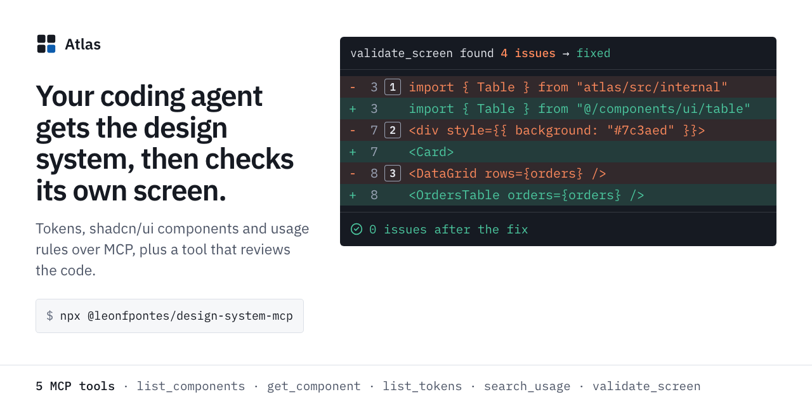
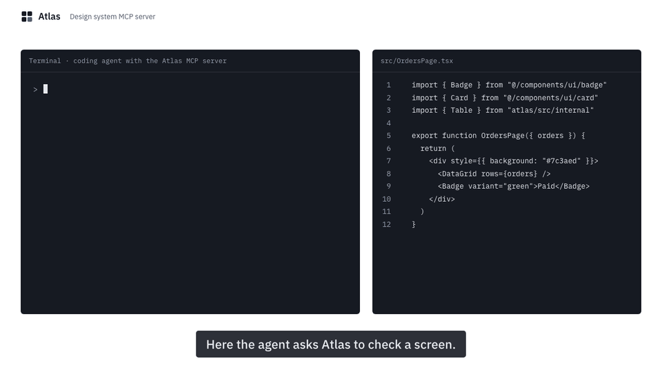
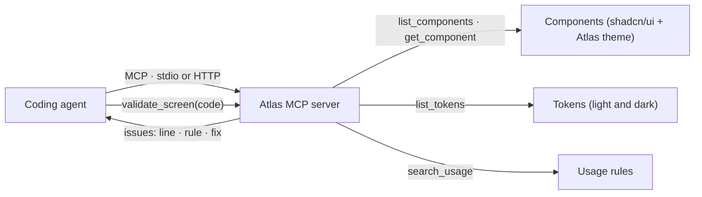

<picture>
  <source media="(prefers-color-scheme: dark)" srcset="docs/cover-dark.png">
  
</picture>

# Atlas · Design System MCP Server

Your coding agent gets the design system, then checks its own screen. Atlas is a design system
built on [shadcn/ui](https://ui.shadcn.com) and an [MCP](https://modelcontextprotocol.io) server
that gives Claude Code, Claude Desktop and Cursor its tokens, components and usage rules, plus a
tool that reviews the code they write. An evaluation measures what that changes.



[Watch the 1-minute video](docs/media/atlas-demo.mp4) (MP4, English captions, no narration;
[captions as WebVTT](docs/media/atlas-demo.en.vtt)).

## The problem

A coding agent that doesn't know your design system invents one: hex colors instead of tokens,
components that don't exist, variants a component doesn't accept, imports from internals. The
screen looks fine in review and drifts from the system with every prompt.

## How it works



| Tool              | Returns                                                           |
| ----------------- | ----------------------------------------------------------------- |
| `list_components` | Every component with a one-line summary and its import line       |
| `get_component`   | Props, variants, examples, do and don't, and the rules that apply |
| `list_tokens`     | Tokens with the CSS variable, Tailwind classes, light and dark    |
| `search_usage`    | Usage rules that match a question                                 |
| `validate_screen` | Issues in a JSX or TSX file, each with a line, a rule and a fix   |

All five only read. The server answers from the same data as the Storybook docs. Contracts:
[docs/API.md](docs/API.md).

## Quickstart

Node 20.19 or newer. No clone needed.

```bash
claude mcp add atlas -- npx -y @leonfpontes/design-system-mcp   # 1. add the server
claude mcp list                                                  # 2. atlas: … - ✔ Connected
claude "Build an orders page with Atlas components"              # 3. ask for a screen
```

Inside Claude Code, `/mcp` lists the five tools.

### Claude Desktop and Cursor

Add the same server to `claude_desktop_config.json` (Claude Desktop: Settings → Developer →
Edit Config) or to `.cursor/mcp.json` in the project (Cursor), then restart the app:

```json
{
  "mcpServers": {
    "atlas": {
      "command": "npx",
      "args": ["-y", "@leonfpontes/design-system-mcp"]
    }
  }
}
```

To use the theme in your app, add the shadcn/ui components and the Atlas tokens to `globals.css`:

```css
@import 'tailwindcss';
@import '@leonfpontes/atlas-tokens/theme.css';
@import '@leonfpontes/atlas-tokens/tokens.css';
```

## Evaluation: the lookups do the work, validate_screen is the safety net

The same model gets the same requests three ways: without Atlas, with the four lookup tools, and
with all five tools. The full server is graded twice: its first draft, before any self-check, and
its final file. A screen is valid with 0 `validate_screen` issues and a passing render test.
Method and limits: [evals/README.md](evals/README.md).

<!-- scoreboard:start (generated from evals/results/latest.json by `pnpm readme`) -->

Same model, same 20 prompts, three setups, three runs each. With the full server, 96.7% of first drafts were valid before any self-check. `validate_screen` costs about 48% more and covers what these 20 prompts don't.

| Metric                    | Without Atlas |   Lookups only | Full · first draft |   Full · final | What it means               |
| ------------------------- | ------------: | -------------: | -----------------: | -------------: | --------------------------- |
| Valid screens             |   23.3% ± 7.6 |    98.3% ± 2.9 |        96.7% ± 2.9 |       100% ± 0 | +75 pts from the lookups    |
| Render test passed        |       35% ± 0 |    98.3% ± 2.9 |        98.3% ± 2.9 |       100% ± 0 | +63.3 pts                   |
| Issues per screen         |   3.28 ± 0.67 |    0.02 ± 0.03 |        0.02 ± 0.03 |              0 | 3.26 fewer with the lookups |
| Tool calls per screen     |             0 |            8.6 |                  — |            9.7 | 1.3 of them validate_screen |
| Tokens per screen         |   5,122 ± 198 | 29,791 ± 2,865 |                  — | 58,311 ± 4,358 | +96% for the safety net     |
| Cost per run (20 screens) |        $0.049 |         $0.091 |                  — |         $0.134 | +48% for the safety net     |

Issues without Atlas, all runs: `unknown-component` 104 · `hard-coded-color` 68 · `invalid-prop` 25. With either Atlas setup: 1. Mean ± standard deviation between runs; "—": the first draft isn't measured on its own.

claude-haiku-5-5 · n = 20 prompts × 3 runs · run 2026-11-26 · Atlas v0.1.0 · total cost $0.82

<!-- scoreboard:end -->

Reproduce with `ANTHROPIC_API_KEY=… pnpm eval`, then `pnpm readme`.

## Decisions

- **shadcn/ui as the base, themed only by variables.** Atlas adds a theme and the variants
  shadcn lacks (`success`, `warning`, `info`); it doesn't redraw components.
  [ADR 0001](docs/adr/0001-pnpm-shadcn-tmcp.md)
- **One pnpm monorepo:** tokens, components, MCP server, evaluation and site version together.
  [ADR 0001](docs/adr/0001-pnpm-shadcn-tmcp.md) · [ADR 0002](docs/adr/0002-package-names-and-layout.md)
- **tmcp for the server:** the same server object serves stdio and a Fetch `Request` on a
  serverless function. [ADR 0001](docs/adr/0001-pnpm-shadcn-tmcp.md)
- **Four fixed rule ids for `validate_screen`** (`hard-coded-color`, `unknown-component`,
  `invalid-prop`, `internal-import`), shared by the tool and the evaluation.
  [ADR 0003](docs/adr/0003-validate-screen.md)
- **Controls are 40 px, 44 px on touch;** status is always color, icon shape and a word.
  [docs/DESIGN.md](docs/DESIGN.md)

## Repository

| Folder            | What it has                                                      |
| ----------------- | ---------------------------------------------------------------- |
| `packages/tokens` | Design tokens (W3C format) and the shadcn/ui and Tailwind themes |
| `packages/ui`     | The 16 components, their manifest and the Storybook              |
| `mcp`             | The MCP server and its five tools                                |
| `evals`           | The evaluation harness, the 20 cases and the results             |
| `site`            | The How it works page, with the Storybook under `/storybook/`    |

```bash
pnpm install && pnpm check   # types, lint, format, tests and build, as in CI
pnpm dev                     # site on http://127.0.0.1:5173
pnpm storybook               # docs on http://127.0.0.1:6006
```

Architecture: [docs/ARCHITECTURE.md](docs/ARCHITECTURE.md). Rules for coding agents:
[AGENTS.md](AGENTS.md). Changes: [CHANGELOG.md](CHANGELOG.md).

## License

[MIT](LICENSE). Built by [Leonardo Pontes](https://www.linkedin.com/in/leonardo-fonseca-pontes-465740103/).
