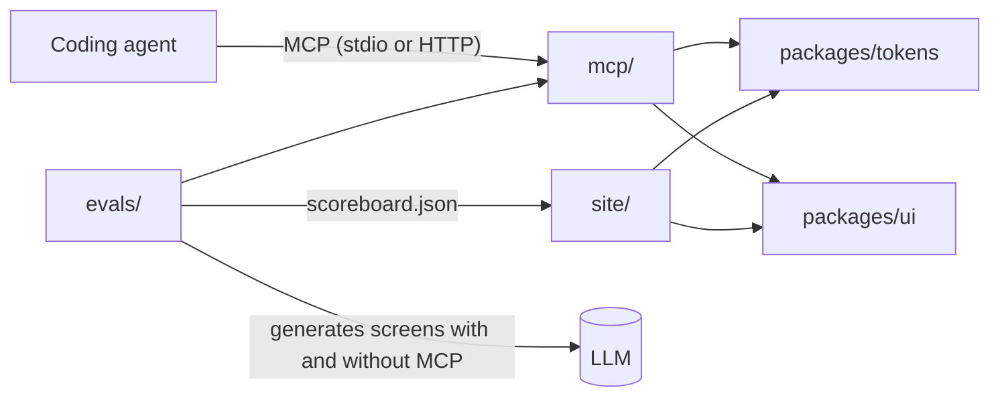

# Architecture

| Folder            | What it has                                                                                                                                                              |
| ----------------- | ------------------------------------------------------------------------------------------------------------------------------------------------------------------------ |
| `packages/tokens` | `@leonfpontes/atlas-tokens`: `tokens.json` (DTCG), the helpers to read it and the build of `tokens.css` and `theme.css`                                                  |
| `packages/ui`     | `@leonfpontes/atlas-ui`: the 22 shadcn/ui components with the Atlas theme, `styles.css`, the component manifest and the Storybook (its build writes `storybook-static/`) |
| `mcp`             | `@leonfpontes/design-system-mcp`: the MCP server, stdio and HTTP ([API](API.md))                                                                                         |
| `evals`           | `atlas-evals` (private): cases, harness, prompts and the results the site and README read                                                                                |
| `site`            | `atlas-site` (private, Vite): How it works, 404, share images and demo; its build copies the Storybook to `/storybook/`                                                  |
| `docs/`           | Plan, design direction, API, this file and the ADRs                                                                                                                      |
| `tests/`          | Repository-wide guards                                                                                                                                                   |

Build order follows the workspace graph (`pnpm -r run build`): tokens → ui (with Storybook) → mcp, evals → site.
Names and toolchain: [ADR 0002](adr/0002-package-names-and-layout.md). The evaluation calls the API with
`fetch`: [ADR 0004](adr/0004-anthropic-api-with-fetch.md).

## Contracts

Types, routes and formats the parts exchange. If one changes here, the doc changes in the same PR.

| Contract                                                                                                                                                                                                                                                                                           | Defined in                                           | Written by                                      | Read by                             |
| -------------------------------------------------------------------------------------------------------------------------------------------------------------------------------------------------------------------------------------------------------------------------------------------------- | ---------------------------------------------------- | ----------------------------------------------- | ----------------------------------- |
| Design tokens (W3C DTCG: `$value`, `$type` inherited from groups, `{alias}`)                                                                                                                                                                                                                       | `packages/tokens/src/dtcg.ts`                        | token build (O1)                                | MCP `list_tokens` (B2), site        |
| Token values: `packages/tokens/tokens.json` (light in `$value`, dark in `$extensions["atlas.modes"].dark`)                                                                                                                                                                                         | `packages/tokens/tokens.json`                        | designer, by hand                               | the build, MCP `list_tokens` (B2)   |
| Theme CSS: `dist/tokens.css` (`:root` and `.dark`, oklch) and `dist/theme.css` (Tailwind v4 `@theme`)                                                                                                                                                                                              | `packages/tokens/src/css.ts` (`buildCss`)            | `pnpm --filter @leonfpontes/atlas-tokens build` | `packages/ui`, site                 |
| AA pairs (text on background, 4.5:1; borders and ring, 3:1)                                                                                                                                                                                                                                        | `packages/tokens/src/contrast.ts` (`CONTRAST_PAIRS`) | —                                               | the token test, MCP (B2)            |
| Evaluation cases (`id`, `prompt`, `expectedComponents`, `notes?`)                                                                                                                                                                                                                                  | `evals/src/contracts.ts` (`parseCases`)              | `evals/cases.json` (O1)                         | harness (T1)                        |
| Scoreboard `evals/results/latest.json` (variants without-mcp, docs-mcp, with-mcp; per variant: % valid, % rendered, issues, tokens and tool calls per screen, cost per run, ± between runs, first draft of with-mcp; model, date, runs, render mode, Atlas and prompt version; per screen results) | `evals/src/contracts.ts` (`Scoreboard`)              | harness (T1)                                    | site (F2), README (F3)              |
| MCP server identity and instructions                                                                                                                                                                                                                                                               | `mcp/src/server.ts`                                  | —                                               | every client                        |
| MCP over HTTP: a Fetch handler that answers on any path                                                                                                                                                                                                                                            | `mcp/src/http.ts` (`createHttpHandler`)              | —                                               | the serverless function             |
| MCP over stdio: `npx @leonfpontes/design-system-mcp`                                                                                                                                                                                                                                               | `mcp/src/stdio.ts`                                   | —                                               | Claude Code, Claude Desktop, Cursor |

`validate_screen` rule ids are fixed ([ADR 0003](adr/0003-validate-screen.md)): `hard-coded-color`, `unknown-component`, `invalid-prop`,
`internal-import` (`ISSUE_KINDS` in `evals/src/contracts.ts`); the MCP tool reports the same four.
